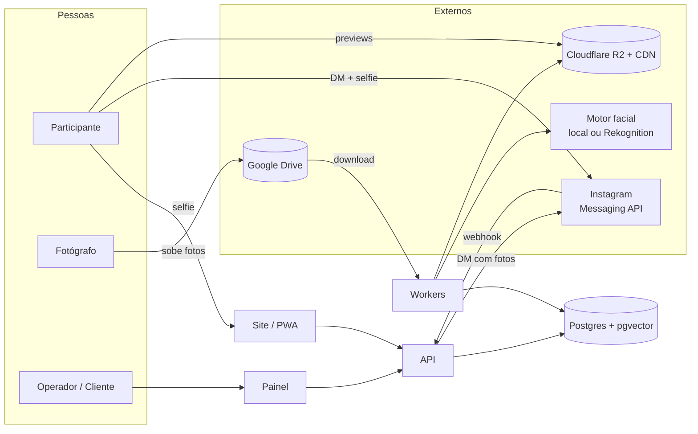
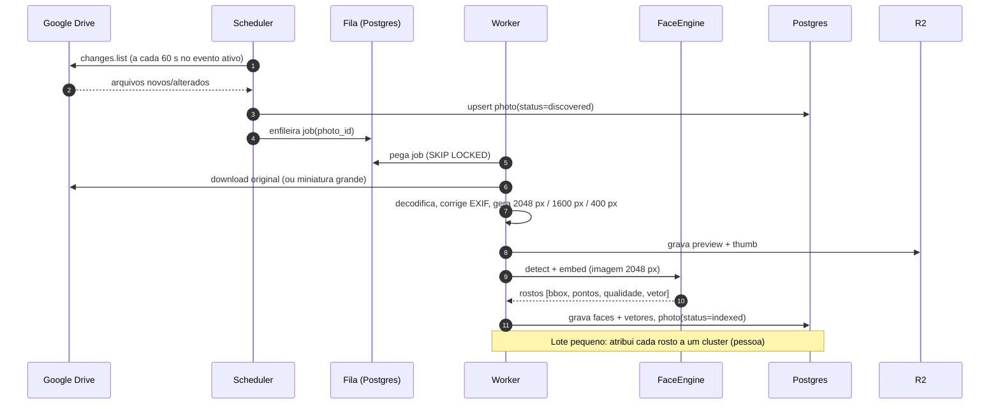
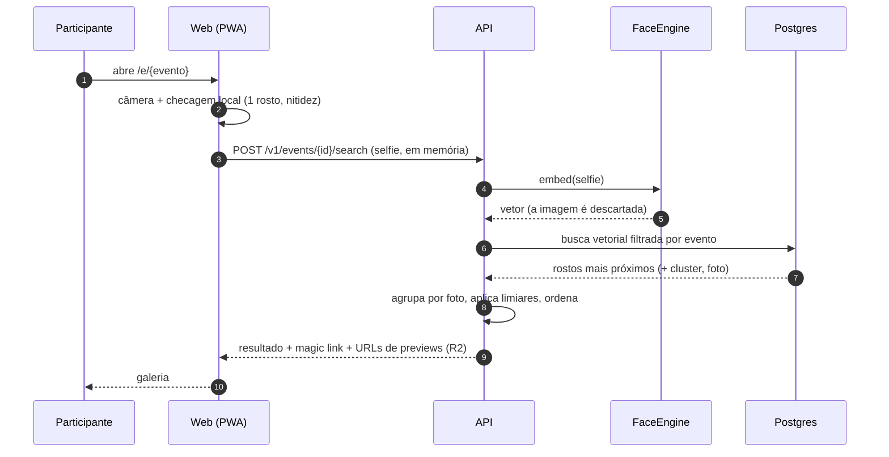
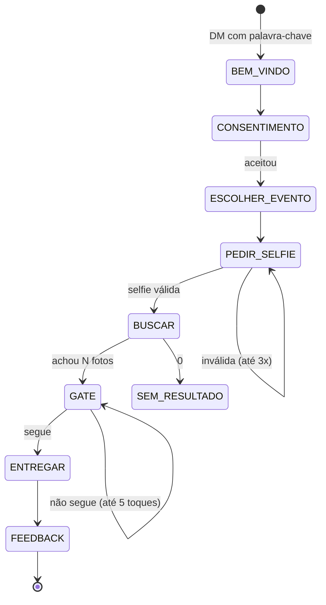

# 03 · Arquitetura

Princípio guia: **o caro é indexar uma vez; o barato é buscar mil vezes.** Toda decisão abaixo empurra o trabalho pesado para uma etapa em lote, assíncrona e idempotente, e deixa a etapa de contato com o usuário leve e rápida.

## 1. Visão de contexto



## 2. Componentes

| Componente | Responsabilidade | Tecnologia | Observação |
|------------|------------------|-----------|-----------|
| **API** | Regras de negócio, autenticação, busca, webhooks | Python 3.12 + FastAPI | Único ponto de entrada; stateless |
| **Worker de ingestão** | Descobrir, baixar, gerar derivados, detectar/embedar rostos | Python (mesmo código da API, outro *entrypoint*) | Escala horizontalmente; CPU |
| **Worker de bot** | Processar eventos do Instagram, enviar DMs respeitando limites | Python | Fila própria; *rate limiter* por conta |
| **Web (site/galeria/painel)** | UI white-label e painel | Next.js (App Router) + Tailwind | Tema por tenant via *design tokens* |
| **Banco** | Dados, vetores, filas, sessões do bot | PostgreSQL 16 + `pgvector` | Uma instância |
| **Objetos** | Previews, thumbs, ZIPs temporários | Cloudflare R2 (S3-compatível) | Egress zero; originais **não** ficam aqui |
| **Proxy** | TLS, domínios dos clientes | Caddy (TLS automático sob demanda) ou Cloudflare | Domínio próprio por cliente |
| **Observabilidade** | Logs, métricas, erros | Sentry (free) + Prometheus/Grafana opcional + UptimeKuma | Alertas por Telegram |

> **Por que um monólito modular?** Um dev, deploy simples, depuração simples. Os limites entre módulos (`ingest`, `faces`, `search`, `bot`, `delivery`, `tenancy`, `billing`) existem como pacotes com interfaces explícitas, de modo que extrair um serviço no futuro é possível, mas não é custo agora.

## 3. Fluxo A — Ingestão (Drive → índice)



**Detalhes que importam**

- **Idempotência:** `UNIQUE(event_id, drive_file_id, md5)`. Jobs repetidos não duplicam rostos.
- **Descoberta:** acompanhar `changes` com *page token* (barato) em vez de varrer pastas recursivamente; na primeira carga, `files.list` paginado. Detecção de pasta `_nao_publicar` (RN9).
- **Derivados:** ler a imagem uma única vez, fazer todos os redimensionamentos com `libvips` (`pyvips`), 5–10× mais rápido que Pillow em arquivos grandes.
- **Detecção em 2048 px:** compromisso entre custo e rostos pequenos (fotos de quadra/ginásio têm rostos de 40–80 px). Para fotos de "plateia" ou "grande angular", o módulo pode **ladrilhar** (tiles com sobreposição) e detectar por ladrilho. Isso é uma opção por evento, desligada por padrão.
- **Falhas:** *retry* exponencial (3×), depois `status=error` com motivo e botão "tentar de novo" no painel. Falha em uma foto nunca bloqueia as outras.
- **Backpressure:** o *scheduler* respeita um teto de downloads simultâneos (cotas do Drive) e de jobs por tenant (isolamento de ruído).
- **Escala em picos:** workers adicionais podem ser ligados sob demanda (mesma imagem Docker em uma VM extra por algumas horas) — ver [08](08-custos-e-precificacao.md).

## 4. Fluxo B — Busca por selfie (site)



**Busca (SQL, simplificado)**

```sql
SELECT f.photo_id, f.cluster_id, f.quality,
       1 - (f.embedding <=> $1) AS sim
FROM   faces f
WHERE  f.event_id = $2 AND f.visible
ORDER  BY f.embedding <=> $1
LIMIT  400;
```

- **Busca exata, não aproximada, no MVP.** Com filtro por `event_id` (índice B-tree), cada evento tem de 10 mil a 500 mil vetores; comparação exata de 512 dimensões em 200 mil vetores leva dezenas de milissegundos e dá 100% de *recall*. **HNSW só quando um evento passar de ~500 mil rostos.** Menos parâmetros para afinar, menos risco.
- **Pós-processamento:** agrupar por foto, ficar com a melhor similaridade por foto; promover fotos cujo rosto pertence ao mesmo **cluster** dos acertos fortes (recupera perfis, capacetes); ordenar por `sim × peso(qualidade)`; separar "Com certeza"/"Talvez".
- **Multi-selfie:** executar a consulta para cada vetor e fundir por máximo (ou média de similaridades).

## 5. Fluxo C — Conversa no Instagram

Detalhado em [05](05-instagram-bot.md). Em resumo:



## 6. Entrega de arquivos

| Item | Onde fica | Como é servido |
|------|-----------|----------------|
| Original | Google Drive do cliente (**fonte da verdade**) | Opção A: *streaming* via API (nosso servidor lê do Drive e repassa). Opção B: link direto do Drive se o cliente tornar a pasta "qualquer pessoa com o link" |
| Preview 1600 px | R2 | CDN, URL assinada com expiração curta |
| Miniatura 400 px | R2 | CDN, cache longo |
| ZIP "todas as minhas fotos" | Não persiste | Montado em *streaming* a partir do Drive/R2 na hora |
| Fotos no DM | Enviadas por URL de preview (≤ 8 MB) | Meta baixa a imagem do nosso CDN |

Por que não copiar originais para o nosso storage: seriam centenas de GB por evento, custo recorrente e o cliente perderia a sensação de posse. Por que não servir tudo direto do Drive: velocidade imprevisível, cotas de download por arquivo, sem controle de acesso por pessoa e exposição pública da pasta inteira.

## 7. Multi-cliente (tenancy)

- **Banco compartilhado, esquema compartilhado, `tenant_id` em toda tabela**, protegido por **Row-Level Security** do Postgres (`SET app.tenant_id` por requisição). Fácil de operar e barato; isolamento forte por política, validado por testes.
- **Configuração por tenant** (JSON versionado): marca (logo, cores, fontes), domínio, textos do bot, palavras-chave, gate on/off, limiares, retenção, idioma, políticas para menores, limites do plano.
- **Domínios próprios:** `fotos.cbde.org.br` aponta para o FLASH!; certificado emitido automaticamente.
- **Aparência sem fork:** *design tokens* em CSS variáveis carregados por tenant; componentes de UI não conhecem cores fixas.
- **Instagram por tenant:** cada cliente conecta sua conta via OAuth ao **mesmo app Meta** (Tech Provider). Tokens criptografados por tenant.

## 8. Implantação

```text
VPS no Brasil (4 vCPU · 8 GB · NVMe)
 ├─ caddy              (TLS, domínios dos clientes)
 ├─ web                (Next.js)
 ├─ api                (FastAPI, 2 réplicas)
 ├─ worker-ingest      (N processos, 1 por vCPU livre)
 ├─ worker-bot
 ├─ postgres + pgvector (volume dedicado, backup noturno para R2)
 └─ (opcional) prometheus / grafana / uptime-kuma
Cloudflare: DNS, CDN, R2, (Turnstile anti-bot no site)
```

- **Ambientes:** `dev` (local, `docker compose up`), `staging` (VPS pequena), `prod`.
- **Deploy:** imagem Docker por *tag* → `docker compose pull && up -d`, com *health checks* e *rollback* para a imagem anterior. Sem Kubernetes.
- **Hospedagem no Brasil** reduz latência e simplifica a LGPD (transferência internacional — art. 33). Candidatas: Oracle Cloud (São Paulo/Vinhedo), AWS `sa-east-1`, GCP `southamerica-east1`, Magalu Cloud, provedores de VPS nacionais. Compare preço/vCPU no Spike S6.
- **Backups:** `pg_dump` + WAL para R2 criptografado; **teste de restauração mensal** (backup não testado não existe).
- **Escala horizontal quando precisar:** (1) mais workers em VMs efêmeras; (2) réplica de leitura do Postgres; (3) separar o worker de bot; (4) HNSW; (5) só então pensar em serviço de vetores dedicado (Qdrant).

## 9. Segurança em camadas (resumo, detalhes em [07](07-seguranca-lgpd-abuso.md))

- Webhook da Meta: validação da assinatura `X-Hub-Signature-256` e deduplicação por `mid`.
- Tokens e segredos: criptografia com chave mestra fora do banco (KMS/age/SOPS); rotação.
- Autenticação do painel com sessões curtas; RLS por tenant; auditoria.
- Upload de selfie: tipo/tamanho validados, processamento isolado em memória, `EXIF` removido, **sem persistência**.
- Proteção contra abuso: *rate limit* por IP/usuário/conta IG, Turnstile no site, detecção de varredura de rostos.

## 10. Desempenho e custo — decisões que pagam a conta

| Decisão | Efeito |
|---------|--------|
| Detectar em 2048 px, não no original de 24 MP | 4–8× menos CPU e I/O |
| Fila no Postgres | Elimina Redis/RabbitMQ |
| Busca exata + filtro por evento | Elimina serviço de vetores |
| Previews no R2, originais no Drive | Armazenamento e egress ≈ R$ 0 |
| Index única por foto, busca barata | Custo marginal por participante quase zero |
| Embeddings em `halfvec` (16 bits) se necessário | Metade da memória/disco, perda de precisão desprezível (validar) |
| Workers efêmeros para picos | Paga CPU só nas horas de evento |
