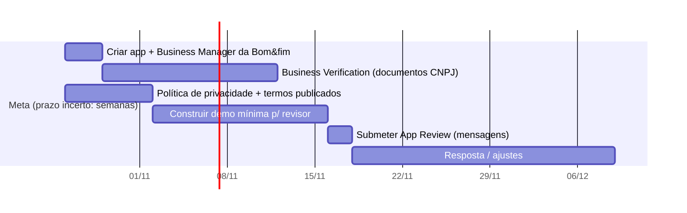

# 05 · Bot do Instagram

## 1. O que a plataforma da Meta permite (verificado em out/2026)

| Tema | Regra | Impacto no FLASH! |
|------|-------|-------------------|
| **API** | "Instagram API com Instagram Login" (permissões `instagram_business_basic`, `instagram_business_manage_messages`). A alternativa é a versão com Facebook Login. | Usar a primeira: não exige Página do Facebook, onboarding mais simples para o cliente |
| **Conta** | Instagram **Profissional** (Business ou Creator) | Pré-requisito do cliente |
| **Quem inicia** | O app só pode mandar mensagem **depois** que o usuário escreveu para a conta | Bot é sempre reativo; nunca envia "frio" |
| **Janela** | 24 h após a última ação do usuário (7 dias se vier de anúncio Click-to-Direct) | Cada toque do usuário reabre a janela; o *follow gate* deve usar **botões** (postback) |
| **Comentário → DM** | *Private reply* a comentário: 1 por comentário, em até 7 dias | Gatilho "comente QUERO" em post do evento |
| **Mídia enviada** | Imagem PNG/JPEG ≤ **8 MB**; até **10 anexos por mensagem**; vídeo/áudio ≤ 25 MB; texto ≤ 1000 bytes | Entregar 10 fotos por mensagem |
| **Webhooks** | `messages`, `messaging_postbacks`, `messaging_optins`, `messaging_referrals`, `messaging_reactions`, `messaging_seen` (+ `comments` para comentários) | Assinar `messages` e `messaging_postbacks` no mínimo |
| **Perfil do usuário** | `GET /<IGSID>?fields=name,username,is_user_follow_business,...` retorna se o usuário **segue** a conta (consentimento existe porque ele escreveu) | É o que viabiliza o *follow gate*. Se o usuário bloqueou a conta, o dado não vem |
| **Limites de taxa** | Documentação pública: ~300 chamadas/s (texto) e ~10/s (mídia de áudio/vídeo) por conta; *private replies* 750/h. Há divergência entre páginas da Meta | Implementar *token bucket* conservador por conta (ex.: 20/s) e tratar erro 80002 com *backoff* |
| **App Review** | Para atender contas de terceiros é preciso **Advanced Access** → exige **App Review + Business Verification**. Se não houver tela navegável para o revisor, a aprovação pode se limitar a permissões sem mensagens | **Caminho crítico do projeto.** Preparar vídeo-demonstração e telas |
| **Humano** | Permissão de mensagens habilita a tag "Human Agent" (7 dias) apenas para atendimento humano | Handoff (E3.10) |

> **Confirmar antes de codificar** (Spike S4): limites de taxa vigentes, tamanho máximo/URL aceitos por imagem, comportamento do `is_user_follow_business` para contas privadas, e se um app que acessa apenas ativos do **próprio** negócio dispensa App Review (isto permitiria um piloto da CBDE sem esperar a aprovação geral). Não assuma.

## 2. Caminho de aprovação (comece no dia 0)



Plano B enquanto aguarda: modo de desenvolvimento (só contas com função no app: você, a CBDE como testadora) para os primeiros eventos; ou ponte via ferramenta de chatbot já aprovada (ex.: ManyChat chamando a **API do FLASH!** por *external request*) apenas no piloto — com a ressalva de LGPD (mais um operador no caminho do dado) e dependência de terceiro.

## 3. Máquina de estados da conversa

Estado persistido em `bot_sessions(tenant_id, igsid, state, event_id, selfie_vec, attempts, consent_at, updated_at)` com TTL.

| Estado | Entrada | Ação do bot | Saída |
|--------|---------|-------------|-------|
| `NOVO` | Qualquer DM / ice breaker / comentário | Se bate com palavra-chave → `BEM_VINDO`; senão menu | |
| `BEM_VINDO` | | Saudação curta + 1 linha de termos + botões [Aceito e continuar] [Ler termos] | `CONSENTIMENTO` |
| `CONSENTIMENTO` | postback `accept` | Grava consentimento versionado | `ESCOLHER_EVENTO` (ou pula se há 1 evento) |
| `ESCOLHER_EVENTO` | postback `event:<id>` | Lista até 13 eventos ativos como *quick replies* (ou carrossel) | `PEDIR_SELFIE` |
| `PEDIR_SELFIE` | imagem | Baixa a imagem da URL da Meta, extrai vetor, **descarta a imagem** | `BUSCAR` ou repete (máx. 3) |
| `BUSCAR` | | Busca; guarda só os IDs das fotos e o vetor | `GATE` (se N>0) ou `SEM_RESULTADO` |
| `GATE` | | "Achei **37** fotos suas 🎉 Para liberar, siga @perfil e toque em **Já segui**" (+ botão "Abrir perfil") | `ENTREGAR` quando seguir |
| `ENTREGAR` | postback `followed` com `is_user_follow_business=true` | 2 mensagens × 10 imagens + link da galeria; fecha com agradecimento + CTA | `FEEDBACK` |
| `SEM_RESULTADO` | | Sugere outra selfie, outro dia/modalidade ou aguardar novas fotos; opção de "avise-me" (usuário precisa mandar nova mensagem para reabrir a janela) | `PEDIR_SELFIE` |
| `FEEDBACK` | | 👍/👎 | `FIM` |

**Regras de robustez**

- **Idempotência:** deduplicar por `mid` da mensagem; webhooks chegam repetidos e fora de ordem.
- **Responder 200 em milissegundos** e processar na fila; a Meta reenvia se demorar.
- **Verificar `X-Hub-Signature-256`** de todo webhook com o *App Secret*.
- **Texto fora do esperado:** em qualquer estado, "menu", "ajuda", "atendente", "cancelar" funcionam.
- **Tempo de espera:** se o usuário sumir no gate, a sessão expira em 24 h; mensagem de lembrete **não** é possível fora da janela — por isso o gate usa botão que reabre a janela.
- **Falha de envio de mídia:** reduzir resolução (≤ 1600 px, ≤ 1 MB), reenviar; se persistir, mandar o link da galeria.
- **Limite por usuário:** no máximo N buscas/dia (padrão 5; modo menores: 10 por dia **por evento** e só com código).
- **Anti-spam da Meta:** não repetir a mesma mensagem em *loop*; o gate tem teto de 5 tentativas e mensagem gentil final.

## 4. O *follow gate* bem desenhado

Seu desenho: selfie → checar se segue → pedir para seguir → repetir até confirmar → só então entregar. Mantemos a lógica, com estes ajustes:

1. **Buscar antes de travar.** A busca custa quase nada; o número real de fotos é o melhor motivo para seguir. (Teaser mostra **quantidade**, nunca as imagens.)
2. **Verificar de verdade:** `GET /<IGSID>?fields=is_user_follow_business`. Se vier `true`, não pede nada (usuário que já segue passa direto, sem fricção).
3. **Loop por botão, não por polling.** Cada toque em "Já segui ✅" é um evento do usuário que (a) reabre a janela de 24 h e (b) dispara nova checagem. Sem tarefas agendadas.
4. **Honestidade:** a mensagem diz claramente o que acontece ("é só seguir o perfil para liberar") — evita reclamação, reduz risco de política da Meta.
5. **Contas privadas / erro de leitura:** se a API não retornar o campo, oferecer entrega via link com *magic link* sem gate ("não consegui confirmar — tente de novo ou peça pelo site"). Nunca travar o usuário indefinidamente.
6. **Medir:** `gate_shown`, `gate_clicked_followed`, `gate_passed`, `gate_dropout`. A taxa de conversão do gate é o número que você vende ao cliente.
7. **Configurável por evento:** gate ligado/desligado; texto; número de tentativas; destino do botão.

## 5. Entrega no Direct

- **Quais fotos:** as 20 melhores por `sim × qualidade × nitidez`, priorizando variedade (não enviar 10 quase iguais — remover quase duplicatas por hash perceptual).
- **Formato:** previews 1600 px, JPEG ≤ 1 MB (rápido e dentro do limite de 8 MB). Marca d'água discreta opcional.
- **Complemento:** "Veja as 142 fotos e baixe em alta: {link}". O link abre a galeria com a busca já feita (*magic link*, sem refazer selfie).
- **Ordem:** primeiro o link (garante entrega mesmo se a mídia falhar), depois as fotos.

## 6. Gatilhos adicionais

| Gatilho | Como | Observação |
|---------|------|-----------|
| **Ice breaker / menu persistente** | "📸 Quero minha foto" aparece no início do chat e no menu | Mais conversão que depender da palavra digitada |
| **Comentário em post** | Webhook `comments`; palavra-chave → *private reply* "te chamei no Direct" | 750/h; só um por comentário; precisa permissão de comentários |
| **Resposta a Story / menção** | Story "Mande QUERO MINHA FOTO" | Janela 24 h |
| **QR code** | Telão/credencial leva a `ig.me/m/<perfil>?ref=<evento>` | `messaging_referrals` traz o `ref`, pré-selecionando o evento |
| **Link do site** | Botão "Receber no Instagram" | Mesma conversa |

## 7. Configuração do fluxo como dado (sem fork)

O fluxo de cada cliente é um JSON validado por esquema; textos ficam num catálogo de mensagens (pt-BR agora; en/es depois). Exemplo reduzido:

```json
{
  "version": 3,
  "triggers": { "keywords": ["quero minha foto", "minhas fotos", "foto"], "ice_breakers": ["📸 Quero minha foto"] },
  "consent": { "required": true, "terms_url": "https://fotos.cbde.org.br/termos", "version": "2026-10" },
  "events": { "ask_if_multiple": true },
  "selfie": { "max_attempts": 3, "min_face_px": 160 },
  "gate": {
    "enabled": true, "target": "@cbde", "max_attempts": 5,
    "show_teaser_count": true, "fallback_on_unreadable": "magic_link"
  },
  "delivery": { "photos_in_dm": 20, "images_per_message": 10, "include_gallery_link": true },
  "limits": { "searches_per_day": 5, "minors_mode": { "enabled": true, "event_code_required": true } },
  "messages": {
    "welcome": "Oi, {first_name}! Eu sou o FLASH! 📸 Vou encontrar suas fotos do {event_name}.",
    "gate_prompt": "Achei {count} fotos suas! 🎉 Para liberar, siga {target} e toque em *Já segui*."
  }
}
```

O painel (E4.5) edita isso por formulário; o JSON cru fica para você (suporte avançado).

## 8. Boas práticas de integração

- Um **único app Meta** para todos os clientes; tokens de longa duração por tenant, renovados antes de expirar (≈ 60 dias) com alerta no painel.
- **Ambiente de teste** com 2 contas Instagram de teste + app em modo de desenvolvimento.
- **Gravar** (anonimizados) os *payloads* de webhook reais como *fixtures* de teste.
- **Registro de políticas:** termos e política de privacidade do FLASH! e de cada cliente publicados e linkados no bot.
- **Monitor de saúde:** falhas de envio, 4xx/5xx da Meta e fila de DMs viram alertas.
- **Conformidade:** não coletar mais do que o necessário; seguir a Política da Plataforma e os Termos da Meta; o *follow gate* deve ser transparente.

## 9. Futuro: outros canais

`ChannelAdapter` com `receive(event)` / `send(message)` e o mesmo motor de fluxo. **WhatsApp Cloud API** é o candidato natural no Brasil (sem *follow gate*; conversas de serviço iniciadas pelo usuário na janela de 24 h costumam ser gratuitas — confirmar a tabela de preços vigente). Telegram e *widget* de site servem para cobertura.
