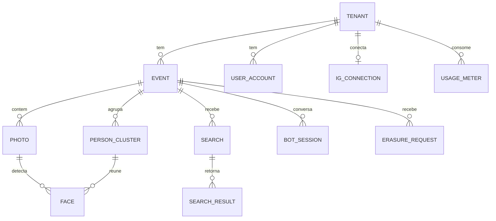

# 06 · Dados e API

## 1. Modelo de dados (PostgreSQL)

Toda tabela de negócio tem `tenant_id` e política RLS: `USING (tenant_id = current_setting('app.tenant_id')::uuid)`.



```sql
-- Extensões
CREATE EXTENSION IF NOT EXISTS vector;
CREATE EXTENSION IF NOT EXISTS pgcrypto;

CREATE TABLE tenant (
  id uuid PRIMARY KEY DEFAULT gen_random_uuid(),
  slug text UNIQUE NOT NULL,
  name text NOT NULL,
  plan text NOT NULL DEFAULT 'event',
  config jsonb NOT NULL DEFAULT '{}',      -- marca, domínio, limiares padrão, textos
  created_at timestamptz DEFAULT now()
);

CREATE TABLE event (
  id uuid PRIMARY KEY DEFAULT gen_random_uuid(),
  tenant_id uuid NOT NULL REFERENCES tenant,
  slug text NOT NULL,
  name text NOT NULL,
  status text NOT NULL DEFAULT 'draft',     -- draft|indexing|open|closed|archived
  starts_on date, ends_on date,
  drive_folder_id text,
  engine text NOT NULL,                     -- 'sface' | 'insightface' | 'rekognition'
  index_version int NOT NULL DEFAULT 1,
  has_minors boolean NOT NULL DEFAULT true,
  access_code_hash text,                    -- código do evento (modo menores)
  retention_until date,                     -- purga de vetores
  config jsonb NOT NULL DEFAULT '{}',       -- τ_alto, τ_baixo, fluxo do bot, facetas
  UNIQUE (tenant_id, slug)
);

CREATE TABLE photo (
  id uuid PRIMARY KEY DEFAULT gen_random_uuid(),
  tenant_id uuid NOT NULL, event_id uuid NOT NULL REFERENCES event,
  drive_file_id text NOT NULL, md5 text NOT NULL,
  name text, width int, height int, taken_at timestamptz,
  facets jsonb DEFAULT '{}',                -- {"dia":"sab","modalidade":"volei"}
  status text NOT NULL DEFAULT 'discovered',-- discovered|processing|indexed|error|hidden
  error text, preview_key text, thumb_key text,
  phash bigint,                             -- hash perceptual (remover quase duplicatas)
  visible boolean NOT NULL DEFAULT true,
  indexed_at timestamptz,
  UNIQUE (event_id, drive_file_id, md5)
);

CREATE TABLE person_cluster (
  id uuid PRIMARY KEY DEFAULT gen_random_uuid(),
  tenant_id uuid NOT NULL, event_id uuid NOT NULL,
  centroid vector(512), size int DEFAULT 0, label text
);

CREATE TABLE face (
  id bigserial PRIMARY KEY,
  tenant_id uuid NOT NULL, event_id uuid NOT NULL, photo_id uuid NOT NULL REFERENCES photo,
  cluster_id uuid REFERENCES person_cluster,
  bbox int[4] NOT NULL, det_score real, quality real,
  embedding vector(512),                    -- nulo se o motor é externo
  external_face_id text,                    -- Rekognition FaceId
  index_version int NOT NULL, visible boolean NOT NULL DEFAULT true
);
CREATE INDEX face_event_idx ON face (event_id) WHERE visible;
-- HNSW somente se um evento passar de ~500 mil rostos:
-- CREATE INDEX face_hnsw ON face USING hnsw (embedding vector_cosine_ops);
```

```sql
CREATE TABLE search (
  id uuid PRIMARY KEY DEFAULT gen_random_uuid(),
  tenant_id uuid NOT NULL, event_id uuid NOT NULL,
  channel text NOT NULL,                    -- 'web' | 'instagram'
  subject_ref text NOT NULL,                -- hash do IGSID/dispositivo, NUNCA a imagem
  quality real, n_certain int, n_maybe int, latency_ms int,
  created_at timestamptz DEFAULT now()
);

CREATE TABLE search_result (
  search_id uuid REFERENCES search, photo_id uuid REFERENCES photo,
  tier text NOT NULL,                       -- 'certain' | 'maybe'
  sim real NOT NULL, rank int NOT NULL,
  PRIMARY KEY (search_id, photo_id)
);

CREATE TABLE bot_session (
  tenant_id uuid NOT NULL, igsid text NOT NULL,
  state text NOT NULL, event_id uuid,
  selfie_vec bytea,                         -- cifrado; TTL 24 h
  attempts int DEFAULT 0, gate_attempts int DEFAULT 0,
  consent_version text, consent_at timestamptz,
  last_mid text, expires_at timestamptz NOT NULL,
  PRIMARY KEY (tenant_id, igsid)
);

CREATE TABLE ig_connection (
  tenant_id uuid PRIMARY KEY, ig_user_id text, username text,
  access_token_enc bytea NOT NULL, expires_at timestamptz, scopes text[]
);

CREATE TABLE consent_log (            -- imutável (só INSERT)
  id bigserial PRIMARY KEY, tenant_id uuid, event_id uuid,
  subject_ref text, channel text, terms_version text, created_at timestamptz DEFAULT now()
);

CREATE TABLE erasure_request (
  id uuid PRIMARY KEY DEFAULT gen_random_uuid(),
  tenant_id uuid, event_id uuid, photo_id uuid, subject_ref text,
  kind text,                              -- 'photo_removal' | 'erase_me'
  status text DEFAULT 'open', due_at timestamptz, resolved_at timestamptz, note text
);

CREATE TABLE usage_meter (            -- base do faturamento e do custo por cliente
  tenant_id uuid, event_id uuid, day date,
  photos_indexed int DEFAULT 0, faces_indexed int DEFAULT 0,
  searches int DEFAULT 0, dm_sent int DEFAULT 0, bytes_out bigint DEFAULT 0,
  engine_cost_usd numeric(10,4) DEFAULT 0,
  PRIMARY KEY (tenant_id, event_id, day)
);

CREATE TABLE audit_log (
  id bigserial PRIMARY KEY, tenant_id uuid, actor text, action text,
  target text, meta jsonb, at timestamptz DEFAULT now()
);
```

A fila de jobs usa a biblioteca escolhida (ex.: `procrastinate` ou `pgqueuer`) sobre Postgres; sem tabela manual.

**Notas**

- `embedding vector(512)`: a dimensão acompanha o motor (SFace = 128; ArcFace = 512). Ajustar por motor e por `index_version`; vetores de motores diferentes não se misturam.
- Tamanho: 512 floats × 4 B ≈ 2 KB por rosto → 1 milhão de rostos ≈ 2 GB + índice. `halfvec` pela metade.
- **Retenção:** job diário `UPDATE face SET embedding=NULL … WHERE event.retention_until < today` + `VACUUM`.
- **Busca "pessoas":** `person_cluster.centroid` pequeno (centenas/milhares por evento).

## 2. API (REST + webhooks)

Convenção: `/v1`, JSON, erros no padrão RFC 9457 (`application/problem+json`), idempotência via cabeçalho `Idempotency-Key` em POSTs sensíveis.

### Públicos (site / participante)

| Método | Rota | Descrição |
|--------|------|-----------|
| GET | `/v1/public/events` | Eventos abertos do tenant (por domínio) |
| GET | `/v1/public/events/{slug}` | Tema, regras, facetas, se exige código |
| POST | `/v1/public/events/{slug}/access` | Valida código do evento → token de sessão curto |
| POST | `/v1/public/events/{slug}/search` | Multipart: 1–3 selfies (**não persistem**). Retorna `search_id`, `certain[]`, `maybe[]`, `magic_link` |
| GET | `/v1/public/galleries/{token}` | Galeria do *magic link* (paginada) |
| GET | `/v1/public/galleries/{token}/photos/{id}/download` | Download do original (stream) |
| GET | `/v1/public/galleries/{token}/zip` | ZIP em *streaming* |
| POST | `/v1/public/photos/{id}/feedback` | "não sou eu" / "remover" |
| POST | `/v1/public/erasure` | Pedido de apagamento |

### Administrativos (painel)

| Método | Rota | Descrição |
|--------|------|-----------|
| POST/GET/PATCH | `/v1/admin/events` | CRUD de eventos |
| POST | `/v1/admin/events/{id}/drive/connect` | Valida pasta |
| POST | `/v1/admin/events/{id}/reindex` | Reindexa |
| GET | `/v1/admin/events/{id}/progress` | Descobertas/processadas/erros |
| GET | `/v1/admin/events/{id}/metrics` | Buscas, conversão, entregas |
| POST | `/v1/admin/photos/{id}/hide` | Oculta |
| GET/PATCH | `/v1/admin/erasure-requests` | Moderação |
| GET/PUT | `/v1/admin/tenant/config` | Tema, bot, limiares |
| GET | `/v1/admin/ig/oauth/start` · `/callback` | Conexão Instagram |

### Webhooks

| Rota | Origem | Notas |
|------|--------|-------|
| `GET/POST /v1/webhooks/meta` | Meta | Verificação de *challenge*; assinatura HMAC-SHA256; resposta 200 imediata; enfileira |
| `POST /v1/webhooks/drive` | Google (opcional) | Se usar `changes.watch`; o MVP usa *polling* |

### Contrato da busca (exemplo)

```json
POST /v1/public/events/cbde-jebs-2026/search
(multipart: selfie[0..2])

200 OK
{
  "search_id": "7c0e…",
  "certain": [ { "photo_id": "…", "sim": 0.71, "thumb": "https://cdn…/t/…jpg", "preview": "https://cdn…/p/…jpg" } ],
  "maybe":   [ { "photo_id": "…", "sim": 0.52, "thumb": "…", "preview": "…" } ],
  "counts": { "certain": 37, "maybe": 12 },
  "magic_link": "https://fotos.cbde.org.br/g/eyJ…",
  "expires_at": "2026-11-21T12:00:00Z"
}
```

## 3. Segurança da API

- Autenticação do painel: sessão httpOnly + CSRF; Magic link para clientes; 2FA na Fase 3.
- Autorização por papel e `tenant_id`; RLS como segunda barreira.
- `magic_link`: JWT/Paseto com `search_id`, `tenant_id`, `exp`; revogável por lista.
- Limites: 30 buscas/min por IP, 5/dia por usuário (configurável), *Turnstile* no site.
- Validação rígida de uploads (tipo MIME real, 10 MB, dimensões máximas); *decoders* sem execução de código.
- Registro de acesso a downloads (sem armazenar conteúdo).

## 4. Versionamento e compatibilidade

- API versionada na rota; mudanças quebram só em `/v2`.
- Esquema do `event.config`/`tenant.config` com `schema_version` e migração.
- Migrações de banco com Alembic; *expand/contract* para zero *downtime*.
